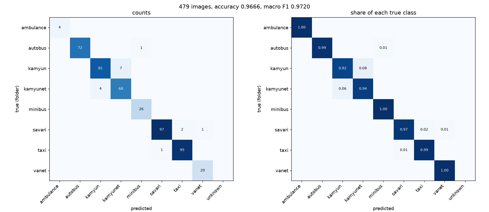
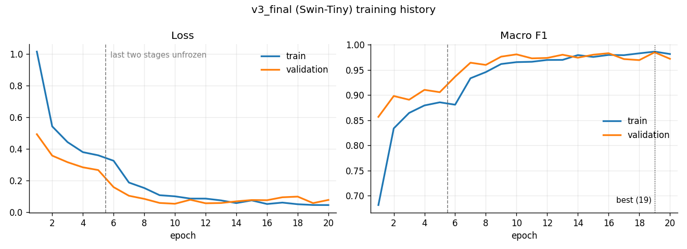

# Vehicle Classifier

Image classifier for vehicles cropped from Iranian traffic-camera images. It sorts each image into one
of 8 classes: `ambulance`, `autobus`, `kamyun` (truck), `kamyunet` (light truck), `minibus`,
`savari` (passenger car), `taxi` and `vanet` (pickup). A separate detector reports the Neysan pickup
as `unknown` instead of accepting it as a `vanet`.

**Final model:** Swin-Tiny (ImageNet pretrained), partially fine-tuned with strong augmentation on
dataset v3, plus a logistic-regression Neysan detector on the model's features.

| Result | Value |
|---|---|
| Validation (755 images) | accuracy 0.9854, macro F1 0.9850 |
| Held-out external test0 (479 images) | **accuracy 0.9666, macro F1 0.9720** |
| Neysan rejection, own held-out Neysan | 67 / 68 |
| Neysan rejection, external test scenarios | 186 / 213 |
| Ordinary test images wrongly rejected | 0 / 479 |

<p align="center">
  
</p>

The dataset is private: no image, checkpoint or private path is in this repository. Data lists record
only relative paths and SHA256 hashes.

## How it works

1. **Input:** the whole image is resized to 224x224 and normalized with ImageNet statistics.
2. **8-class model:** Swin-Tiny (`torchvision.models.swin_t`) with a new `Linear(768, 8)` head. Training:
   head only for 5 epochs, then the last two Swin stages (`features[4:8]`) and the final norm are
   unfrozen with a 10x smaller learning rate.
3. **Neysan detector:** a logistic regression on the 768-number feature vector that feeds the head. If
   p(Neysan) >= 0.5, the output is `unknown`.
4. **`needs_review`:** an image whose top probability is below 0.90 is flagged for a human check. The
   prediction is kept.

## Project journey

Models were selected on validation only. Test sets were used only to report results (the older
400-image Test was used twice, a documented deviation; see [HISTORY](docs/HISTORY.md)).

| Stage | Model | Validation macro F1 | Report |
|---|---|---:|---|
| CNN from scratch | small CNN baseline | 0.8561 | [00](reports/experiments/00_baseline.md) |
| Regularization and schedulers | best CNN combination (augmentation + plateau LR) | 0.8853 | [01-09](reports/README.md) |
| Transfer learning | ResNet18, fine-tuning + augmentation | 0.9482 | [08](reports/experiments/08_resnet.md) |
| Architecture comparison | EfficientNet-B0 / ConvNeXt-Tiny | 0.9485 / 0.9557 | [14-19](reports/README.md) |
| Architecture comparison | Swin-Tiny, fine-tuning + augmentation | 0.9658 | [22](reports/experiments/22_swin_tiny_ft_aug.md) |
| Dataset v3 and relabeling | **Swin-Tiny `v3_final`** | **0.9850*** | [27](reports/experiments/27_v3_dataset_and_final_model.md) |

\* Dataset v3 has a different, larger validation set (755 instead of 659 images), so this number is
not directly comparable with the rows above. On the same external test0, the previous Swin-Tiny model
scored 0.9478 accuracy and `v3_final` 0.9666.

What moved the numbers most:

- **Pretrained models:** the move from a CNN trained from scratch to pretrained models.
- **More data, cleaner labels:** half of the external test0 added to training (dataset v3), and 59
  `kamyun` / `kamyunet` labels corrected to one consistent rule.
- **Training setup:** stronger augmentation and unfreezing one more Swin stage.

<p align="center">
  
</p>

## Quick start

```bash
pip install -r requirements.txt
```

The model files are not in Git. Put `v3_final_best.pt` and `neysan_detector_v3.json` in
`checkpoints/`.

**Test on a folder of labeled images** (one sub-folder per class; sub-folders per test group are
allowed):

```bash
python run_test.py --input path/to/TEST --output results_test
```

This writes a summary, per-image predictions, a confusion matrix and picture pages of the errors,
`unknown` outputs and `needs_review` images. Details: [docs/TEST_GUIDE.md](docs/TEST_GUIDE.md).

**Predict single images** (8-class JSON output, no Neysan step):

```bash
python -m src.predict path/to/image.jpg [more images]
```

**Train the final model** (needs `data/dataset_v3/` and `configs/local_paths.json`, copied from
`configs/local_paths.example.json`):

```bash
python scripts/refresh_split_v3.py                      # data/split_manifest_v3.csv from the folders
python -m src.train_v3 --run-name v3_final --aug strong --unfreeze top2
python scripts/build_neysan_detector_v3.py              # needs_review threshold + Neysan detector
```

Training runs on CPU or GPU and saves `checkpoints/<run>_best.pt` and `reports/v3/<run>_history.csv`.

## Repository layout

```
run_test.py                 test the final model on a folder of images
src/
  train_v3.py               training on dataset v3 (final model)
  train.py                  training for the earlier experiments 00-26
  swin.py resnet.py ...     model definitions (Swin-Tiny, ResNet18, EfficientNet-B0, ConvNeXt-Tiny, CNN)
  dataset.py                dataset and manifest reading
  predict.py                single-image prediction (JSON)
  test_runner.py            test runner, metrics, Neysan detector
  test_report.py            per-test confusion matrices and picture pages
scripts/
  refresh_split_v3.py       rebuild the v3 split files from the folders
  build_neysan_detector_v3.py
  archive/                  scripts of earlier stages (see its README)
decisions/                  data decisions: label corrections, frozen lists, relabel rounds
reports/                    one report per experiment, index in reports/README.md
docs/                       data decisions, test guide, Neysan detector, project history, figures
```

## Documentation

- [Reports index and all validation results](reports/README.md)
- [Report 27: dataset v3 and the final model](reports/experiments/27_v3_dataset_and_final_model.md)
- [Dataset decisions](docs/DATA_DECISIONS.md)
- [Neysan detector](docs/NEYSAN_REJECTION.md)
- [Test guide (`run_test.py`)](docs/TEST_GUIDE.md)
- [Project history before dataset v3](docs/HISTORY.md), with the earlier final models, the frozen
  400-image Test and the Neysan evaluations

## Limitations

- **`kamyun` / `kamyunet`:** this boundary causes most of the remaining errors (11 of 16 on test0).
- **Neysan:** the detector rejects 98.5% of our own held-out Neysan images, but only 87.3% of the
  Neysan images in the external test scenarios.
- **Single runs:** each setting was trained once (seed 42), and validation was used both to select the
  model and to choose the `needs_review` threshold.
- **Same source:** half of the external test0 is in the training data, so test0 measures images of a
  known source, not a completely new camera.
- **Target not reached:** the target of 0.98-0.99 on the external test was not reached.

## Author

Ali Darvish (علی درویش).
